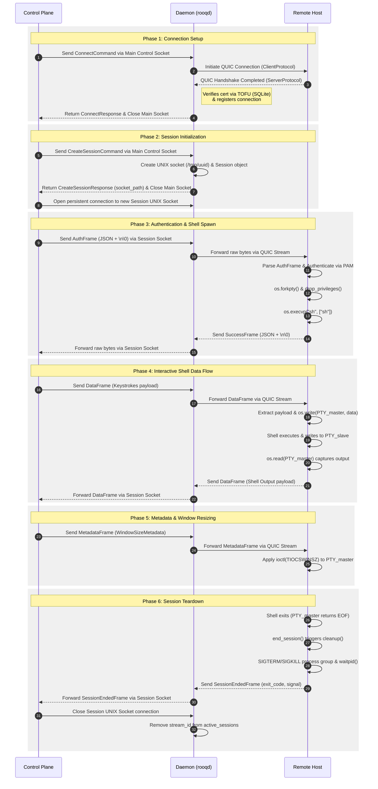
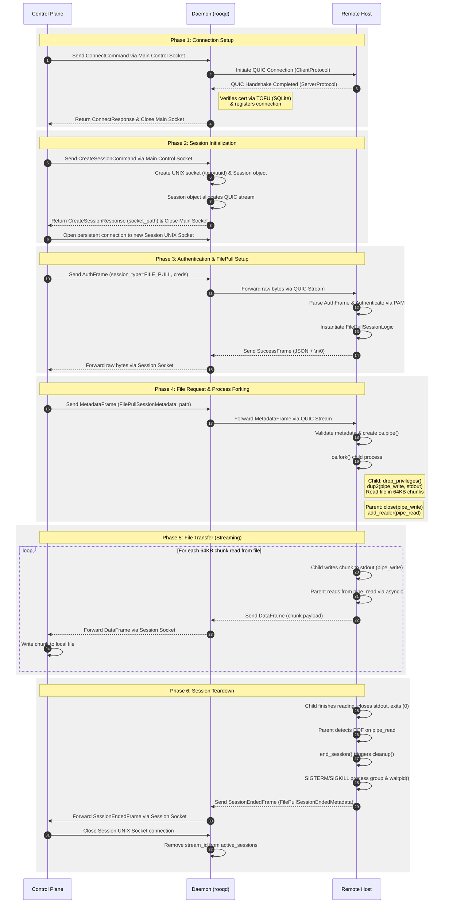

Newfangled protocols are no new thing, neither is reimplementing a perfectly functional piece of utility over it. The only thing that might make such a project worthy of a second glance is if you bring genuine improvement made possible by using said newfangled protocol.

Learnt about QUIC during a project idea generation session. Thought that the idea of multiple reliable and ordered streams sharing one unreliable unordered transport was pretty neat (for both organizational and latency purposes).

Then, I looked at SSH, realized that it was essentially just piping bytes over the network, give or take a few decades of pedantically maintained security and encryption code. I looked at that, and thought, "Man, I could do that but just over QUIC". The rest, is the reason this blog post exists.

---
# Design philosophy
- I wanted to build it out as an actual utility rather than just testing code
- I wanted to build authentication and security into the design rather than shoehorning it in later
- I wanted components to be encapsulated about responsibilities as much as possible

So all in all: I wanted to build it out as something you'd want to use in production, even if it might not be in its current state.

---
# The layers at a glance
We have 2 layers operating together on one host
- The control utility (`rooqctl`) handles giving commands to the local daemon (`rooqd`), handling tty configuration for shell sessions, etc.
- The daemon itself handles maintaining persistent connections with other machines, verifying identity through TOFU (Trust On First Use), negotiating sessions, etc.

These layers communicate with each other through unix domain sockets.
- There is one master socket, (usually `/tmp/rooq.sock`) which is used by the control utility to issue basic commands.
- Thus, the basic units of communication are `Command`/`Response`  structures (detailed below).
- There are session sockets (usually /tmp/{uuid}.sock), one for each, through which session data exchange happens

As for communication between hosts:
- Heartbeats are sent every x seconds to prevent the QUIC connection from dying.
- Every session has its own dedicated QUIC stream.
- The basic unit of communication on a session's stream is a `Frame` (detailed below).

---
# Who talks with whom
A slightly weird thing `rooq` does: establishing a session is something that the control utility asks the daemon to do. All fine till now. But then, after the daemon creates a stream, and the session's dedicated UNIX domain socket, it essentially begins acting as a packet forwarder between the control utility and the remote host.

Ahh well, there you be, castaway; let me help you onto my metaphorical thought dinghy and explain it to you with less whiplash.

On a connection, once a session is established and session socket created, the control utility begins talking _directly_ with the remote host (with respect to data flow and logic, not necessarily the wire path). The daemon on the local host acts simply as a passer of packets, passing incoming packets on the domain socket to the stream, and passing incoming stream data onto the socket.

Why? Because the control utility is the one who deals with stream data. If it's a terminal session, the control utility is the one needing to deal with coordinating terminal sizes, and it's the control utility who deals with tty data, not the daemon. If it's a file pulling session, the control utility is the process running with the user's uid, and is thus eligible for writing a pulled file to disk while maintaining access control.

---
# Protocols
## Control plane
Communication between layers, and communication between machines, both use structured type discriminated Pydantic union models to ensure communication and type safety.

Local control uses the concept of a "Command" and a "Response", where the bases for each look like:
```python
class BaseCommand(BaseModel):
	command: Literal["frank_abagnale"]
```
and
```python
class BaseResponse(BaseModel):
	response_type: Literal["rms"] = "rms"
	status: str = "success"

	def to_message(self) -> str: # for pretty printing error messages
		raise NotImplementedError
```

If we were to look at a Command/Response pair for an operation, say, to connect to a server:
```python
class ServerDetails(BaseModel):
	alias: str | None = None
	host: IPvAnyAddress
	port: int

# Command
class ConnectCommand(BaseCommand):
	command: Literal["connect"] = "connect"
	server: ServerDetails
	config_path: pathlib.Path
	can_trust: bool

# Corresponding response
class ConnectResponse(BaseResponse):
	response_type: Literal["connect"] = "connect"

	def to_message(self) -> str:
		return "connected"
```

Each of these Command/Response models are cobbled into a Command and Response discriminated union, as follows:
```python
Command = Annotated[Union[..., ConnectCommand, ...], Field(discriminator="command")]

Response = Annotated[Union[..., ConnectResponse, ...], Field(discriminator="response_type")]
```

However, python throws a curveball on us: we cannot directly `model_validate` a discriminated union, so we're forced to make a container type:
```python
class CommandContainer(BaseModel):
	command: Command # union

class ResponseContainer(BaseModel):
	response: Response # union
```

## Between hosts
There isn't a concrete command-and-response expectation for inter-host communication. Rather, data is reasoned about in `Frame`s, whose base looks like this:
```python
class BaseFrame(BaseModel):
	type: Literal["trofim_lysenko"] # if you hadn't clocked it by now
									# my sentinels are quite whimsical
```

A particular frame, say, an AuthFrame (sent by the local host to the remote one at the beginning of a session for user authentication), looks like this:
```python
class AuthFrame(BaseFrame):
	type: Literal["auth"] = "auth" # type: ignore
	session_type: SessionType
	username: str
	password: str
```

"How is control flow maintained then?" you ask, eh? Well, for that, we have `SuccessFrame` and `FailureFrame`:

```python
class SuccessFrame(BaseFrame):
	type: Literal["success"] = "success" # type: ignore

class FailureFrame(BaseFrame):
	type: Literal["failure"] = "failure" # type: ignore
	error: str
```
A `FailureFrame` has an `error` field so that this error can be presented to the user, if required.
> Receiving a `SuccessFrame` after sending down a frame acts as an ACK for an operation requiring it. Authentication requires an ACK, or a failure message. A `DataFrame` does not, because it isn't something actionable as far as the application or protocol is concerned. 

# About security
I kept the TOFU (Trust On First Use) model SSH uses. QUIC servers (of any kind) mandatorily have TLS Certs. I simply pin the SPKI (Subject Public Key Info, a field that can be kept constant with renewal) of a remote host the first time I connect, by storing it in a local SQLite database.

`rooqctl` is written to distrust by default, requiring you to pass `--can-trust` to a connect command before the host is trusted.

# A word paints a thousand pictures
Show me what a session looks like, you say eh? Let me indulge you with some process diagrams (which I most definitely did not ask an LLM to generate by pasting the whole codebase into context).

So, for a shell session, it looks roughly like this:


And for a file pull session, like this:


# A few (actually, just two) things
Now that we have all this in front of us, I have a few things I want you to consider:
- Security is not an afterthought, nor is it tacked on. Sessions' child processes drop their privileges to the level of the authenticated user. Communication between them is done purely through PTY's and pipes, both of which are tried and tested for secure IPC. This is done even for a file pulling session, because access control matters.
- File pulling sessions are not simply shell sessions in a jumpsuit. Instead of piping text and mucking about with PTY's at both ends as you would with SSH, here, it's just bytes taking a relatively straightforward path from the remote straight to your disk. Avoiding PTY's may not be that much of a compute or memory saver, sure, but if our improvements come for free, I don't see how that's anything but good.

# Get this article over with, moron
A very easy thing to do would've been to write a client and server script, have each client instance spin up one QUIC connection to the server, implement remote shell on it, and call it a day.

Instead, I indulged in a multi-week undertaking to create what I believe is a production-grade design. Please note that I am calling only the design production-grade. The code is not very mature. It may have a few asyncio mistakes here and there, a missing check or two, all of which could cause meltdowns in production. The design however, I believe, is durable.

I did so, for a simple reason: I like architecting grand things. I like imagining multi-node distributed systems, how they'd interact with each other, what'd be the bottlenecks, the use cases, etc.

Only somewhat recently have I gained sufficient skill to execute such visions to create functioning prototypes.

It is true that I started this project by looking at what SSH does, and by thinking that I could do it better through a different protocol. But think about it; QUIC is not merely "better" simply because it is a newer protocol. It is better because it brings real improvements like:
- Single step handshakes
- Outsourcing encryption to proven TLS
- Multiplexing without head of line blocking

SSH does all three of those things manually in a way that is suboptimal compared to what QUIC offers. When I learnt about QUIC, and considered this idea, I could not stop thinking "The protocol fits like a glove. What's stopping me from implementing this in quite an ergonomic fashion?"

Well, when that thought hit, I was a month into holidays after high school and entrance exams. My brain was practically begging for intellectual engagement.

And the rest is (my git) history.